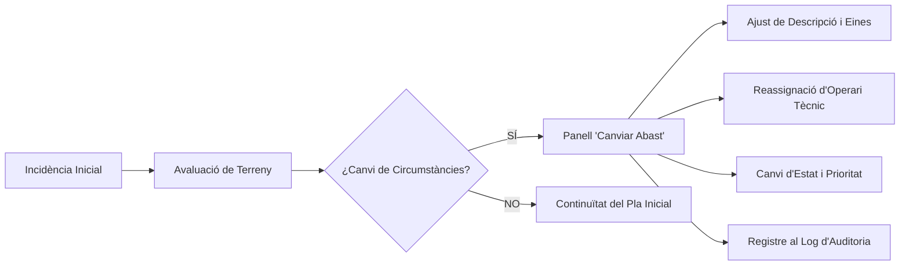
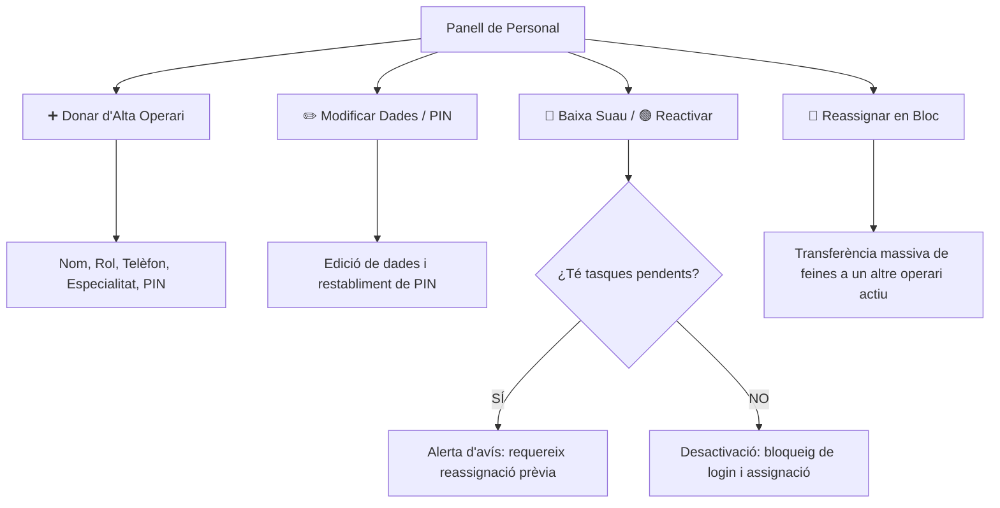

# Especificació Tècnica i Arquitectura UX/Frontend: PWA Brigada Municipal
**Ajuntament de Santa Eugènia (Mallorca - 07142)**
*Actualitzat el 26 d'octubre de 2026: Gestió d'Abast, Reassignació d'Ordres i Especialitat de Climatització.*

---

## 1. Gestió Dinàmica d'Abast i Reassignació de Responsable

En l'operativa diària de la brigada municipal és habitual que una incidència inicial requereixi un abast tècnic superior o la reassignació a un altre operari especialitzat. S'ha integrat un mòdul de gestió dedicat tant a la interfície com a la base de dades PostgreSQL:

### Funcionalitats Clau del Mòdul:
1. **Accés Directe des del Dashboard**: Botó destacat `✏️ Canviar Abast` a cada fila de la taula d'ordres de treball i en les finestres emergents dels pins del mapa interactiu.
2. **Camps Modificables en Temps Real**:
   - **Títol i Descripció d'Abast**: Ajust del treball requerit, peces de recanvi o canvis detectats in situ.
   - **Especialitat Tècnica**: Reclassificació entre *Climatització*, *Electricitat*, *Fontaneria*, *Obra/Paleteria*, *Peó/Neteja*, *Jardineria* o *Senyalització*.
   - **Operari Responsable**: Desplegable amb tot el personal de la brigada mostrant clarament la seva especialitat (ex. *Pere Ramis — [Oficial Climatització]*), amb opció de deixar la tasca sense assignar.
   - **Nivell de Prioritat**: Reajust a *Urgent*, *Alta*, *Normal* o *Baixa*.
   - **Estat de la Tasca**: Transició fluida entre estats (`pendent`, `assignada`, `en_curs`, `pendent_material`, `finalitzada`).
   - **Motiu de la Modificació**: Camp per a auditoria de control intern municipal.
3. **Persistència a Supabase**: La funció [`fn_modificar_abast_tasca()`](file:///C:/Users/jlurracam/.gemini/antigravity/scratch/brigada-mantenimiento/docs/arquitectura-supabase.sql) enregistra cada canvi afegint una entrada cronològica a la columna JSONB `historial_canvis`.

---

## 2. Nova Especialitat: Climatització i Calefacció

S'ha incorporat l'especialitat de **Climatització** a tots els nivells del sistema per cobrir el manteniment d'aires condicionats, bombes de calor i calderes en dependències municipals (Escoleta Infantil, Poliesportiu, Casa de la Vila, etc.):

1. **Tipus ENUM a Base de Dades**:
   - `categoria_tasca`: Afegit el valor `'climatitzacio'`.
2. **Personal Tècnic Especialitzat**:
   - **Pere Ramis**: Oficial especialista en Climatització i Calefacció (Tel: `644556677`).
   - Integrat al selector de login d'operaris, a les targetes de personal i al desplegable de reassignació.
3. **Filtres del Dashboard**:
   - Selector a la capçalera per a visualitzar exclusivament ordres de climatització.
   - Distintiu visual propi en tons blaus/cian (`#E0F2FE` / `#0369A1`) per a una identificació immediata.
4. **Formularis de Nova Incidència i Edició**:
   - Inclouen la categoria «Climatització / Aire condicionat / Calefacció» com a opció destacada.

---

## 3. Gestió Integral del Personal de Manteniment (CRUD: Alta, Baixa i Modificació)

S'ha implementat el cicle de vida complet del personal de la brigada municipal a la pestanya de **Personal** del panell d'administració:

### Funcionalitats Clau del Mòdul de Personal:
1. **Alta de Nou Personal**:
   - Botó destacat «➕ Donar d'Alta Operari».
   - Formulari modal amb validació de: Nom complet, NIF/DNI, Categoria/Rol (Oficial 1a, Oficial 2a, Peó Especialista, Cap d'Equip), Especialitat principal (incloent Climatització), Telèfon de contacte i PIN personal de 4 dígits (inicial per defecte o personalitzat).
2. **Modificació de Dades i Restabliment de PIN**:
   - Cada targeta d'operari disposa d'un botó «Editar».
   - Permet canviar l'especialitat, el telèfon, el càrrec i canviar/resetejar el PIN d'accés en cas d'oblit.
3. **Baixa Suau (*Soft-Delete*) i Reactivació**:
   - Botó d'acció ràpida «Donar de Baixa» / «Reactivar».
   - **Integritat referencial garantida**: No s'eliminen els registres per preservar l'historial d'auditoria i informes PDF de feines finalitzades.
   - Si un operari amb tasques en curs o pendents és donat de baixa, el sistema mostra un avís alertant que cal utilitzar la reassignació en bloc.
   - Els operaris de baixa s'oculten automàticament del selector d'accés mòbil per PIN i del desplegable d'assignació de noves incidències.
4. **Filtres d'Estat del Personal**:
   - Pestanyes ràpides a la vista de personal: **Tots**, **Actius** i **De Baixa**.
5. **Reassignació en Bloc per Incapacitat o Vacances**:
   - En un sol clic transfereix totes les ordres en estat `pendent` o `assignada` a un altre company en actiu.

---

## 4. Millores Operatives de Camp (Mobil & Offline)

1. **Navegació GPS Directa**:
   - Cada targeta d'ordre de feina en la vista d'operari disposa del botó «Com arribar».
   - Obre automàticament la ruta a Google Maps (`https://www.google.com/maps/dir/?api=1&destination=LAT,LNG`) amb les coordenades GPS de la via o llogaret de Santa Eugènia.
2. **Indicador d'Estat de Xarxa (Online / Offline)**:
   - Indicador dinàmic a la capçalera (`En línia` en verd / `Sense cobertura (Local)` en ambre).
   - Registrat mitjançant escoltadors de finestra per alertar l'operari si el terminal es troba fora de cobertura a camins rurals o soterranis municipals.

---

## 5. Verificació de Canvis en Directe

La PWA actualitzada està disponible a [index.html](file:///C:/Users/jlurracam/.gemini/antigravity/scratch/brigada-mantenimiento/index.html) i al servidor local actiu:
👉 **[http://localhost:8080](http://localhost:8080)**
